# Veyl: Windows PC Health Monitor, Hardware Monitor and Crash Analyzer

**Veyl is a Windows 11 and Windows 10 system monitor that shows why your PC is slow, hot or unstable.**
It combines a Task Manager–style process monitor, a hardware sensor monitor (CPU and GPU
temperatures, fan speeds, voltages, power), an FPS counter and in-game overlay with frame-time
analysis, a blue screen (BSOD) analyzer, an application crash viewer, a network packet capture tool and long-term
performance history in one window. Every number comes from real Windows data. Nothing is
estimated, and no telemetry leaves your PC.

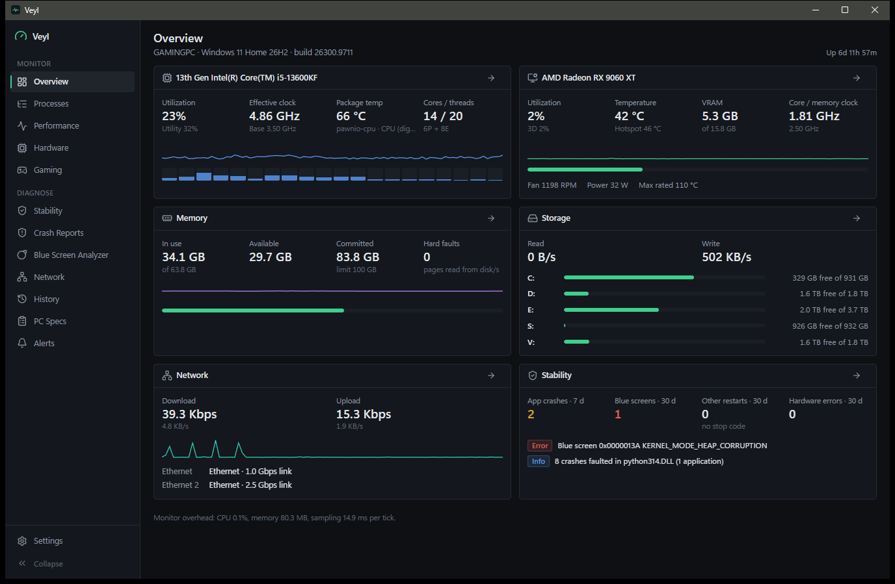

[](#system-requirements)
[](ARCHITECTURE.md)
[](#privacy-and-security)

**[Download the latest release](https://github.com/LunoviaVR/Veyl/releases/latest)** ·
[Features](#features) · [Install](#download-and-install) · [FAQ](#faq) ·
[Troubleshooting](#troubleshooting) · [Build from source](#build-from-source)

---

## Why Veyl

Finding the cause of a crash, a stutter or an overheating PC usually means juggling Task
Manager, a sensor tool, an FPS overlay, Event Viewer, WinDbg and a packet sniffer. Veyl puts
those views side by side and links them:

- **Evidence, not guesses.** Each crash, blue screen and unexpected restart is shown with the
  Windows events behind it and the CPU load, temperatures and memory Veyl recorded just before
  it happened.
- **Real readings only.** If Windows or a driver does not report a value, Veyl shows "—" and
  explains why. It never shows a made-up 0.
- **Nothing installed behind your back.** Veyl installs no drivers, changes no Windows
  settings, never clears event logs and never deletes crash dumps.
- **Private by design.** All history stays in a local database. The only network requests are
  the optional update check and optional debug-symbol downloads.
- **Light.** About 0.1 % of total CPU while monitoring ([measurements](PERFORMANCE.md)).

## Features

### Real-time system monitor and Task Manager alternative

Live CPU, GPU, memory, disk and network usage, with per-core load and clock speed. The process
list shows apps with a visible window first, like Task Manager. It also covers CPU, memory,
commit, disk and network I/O, GPU and video memory per process, plus a process tree, services,
startup apps and active network connections. You can end a task or a whole process tree and change
priority, with safeguards that protect critical Windows processes and detect reused process IDs.

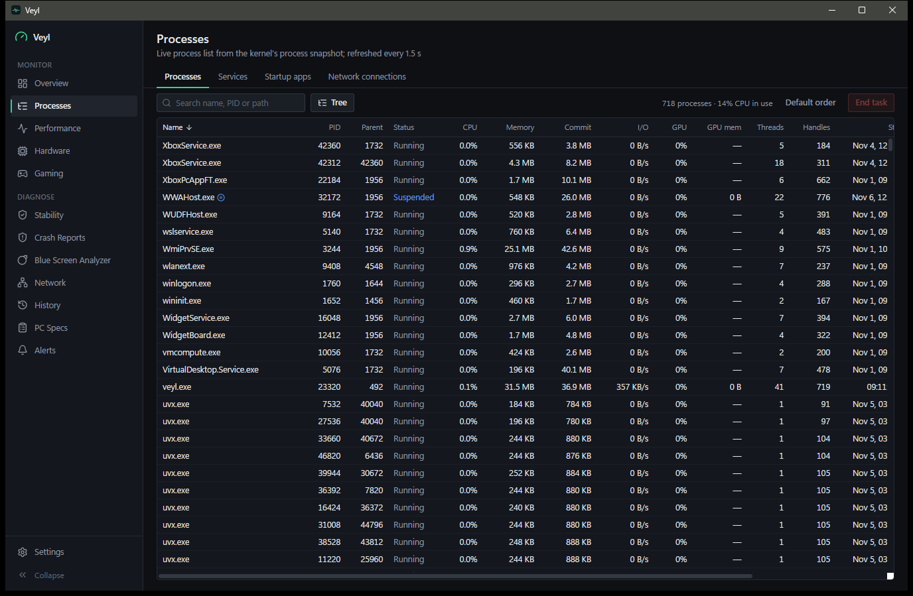

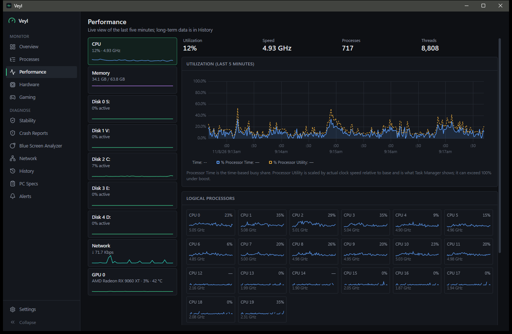

### Hardware monitor: CPU temperature, GPU hotspot, fan speeds and voltages

A sensor table with current, minimum, maximum and average values, built on in-house sensor
providers:

- **CPU:** package and per-core temperatures for Intel CPUs, and package and core power (RAPL).
- **GPU:** temperature, hotspot, fan speed, clocks, power and VRAM. AMD GPUs use ADLX, NVIDIA
  GPUs use NVML, and any GPU gets what Windows (WDDM) reports.
- **Motherboard:** fan speeds, voltages and temperatures on Nuvoton NCT6796–NCT6799 Super I/O
  chips.
- **Drives:** NVMe health (SMART), wear and temperature.

CPU and motherboard sensors need the free, signed [PawnIO](https://pawnio.eu) driver, which you
install yourself.

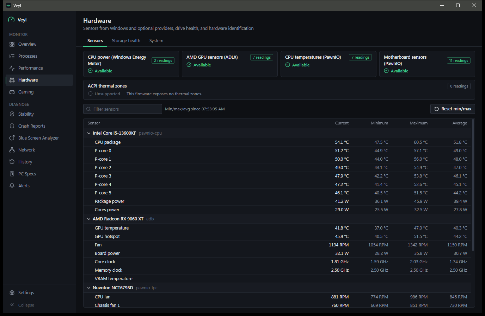

### Blue screen (BSOD) analyzer and crash dump analysis

Veyl separates real bugchecks (blue screens with a stop code) from unexpected shutdowns such as
power loss or a forced power-off. It explains each stop code and lists the minidumps and live
kernel reports Windows kept. One click runs `!analyze -v` with Microsoft's Debugging Tools to show
the faulting driver or module. It also shows what your PC was doing in the minutes before the
crash.

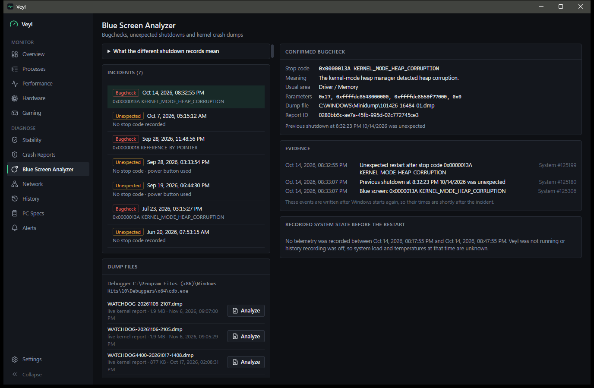

### Application crash reports

Every app crash and hang (Application Error 1000, Application Hang 1002) is listed with its
exception code and meaning, faulting module and version, the linked Windows Error Reporting
report, related events and the recorded system state. Group by app, module or exception to spot
repeat offenders.

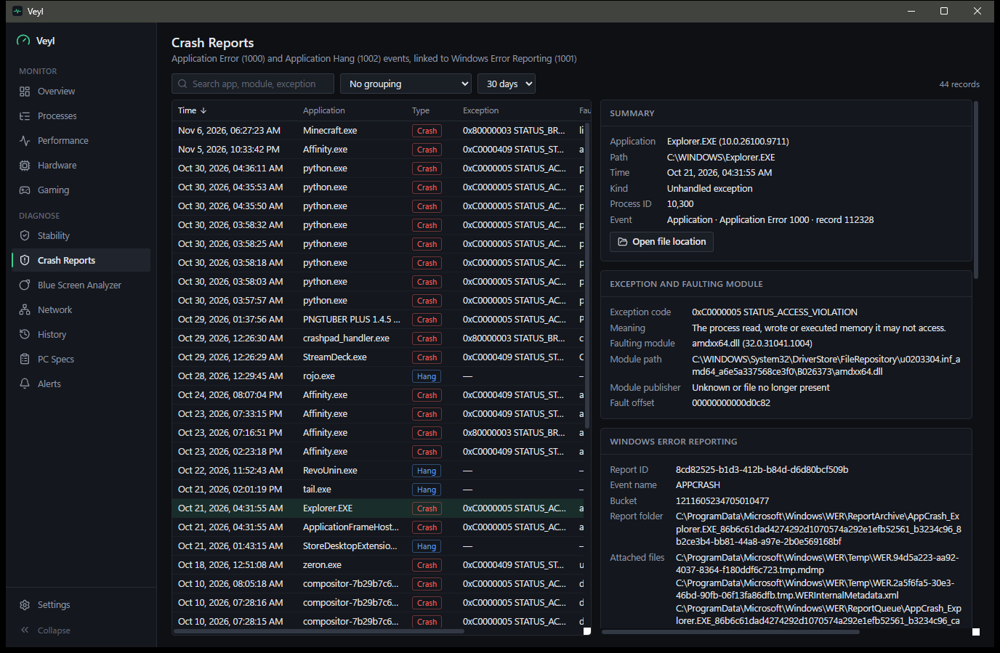

### Stability timeline and diagnostics

A plain-language list of findings, such as "8 crashes faulted in the same DLL" or "Blue screen
0x13A", each with its evidence. Below it are a daily chart of crashes, shutdowns and hardware
errors (WHEA) and a searchable timeline of Windows reliability events.

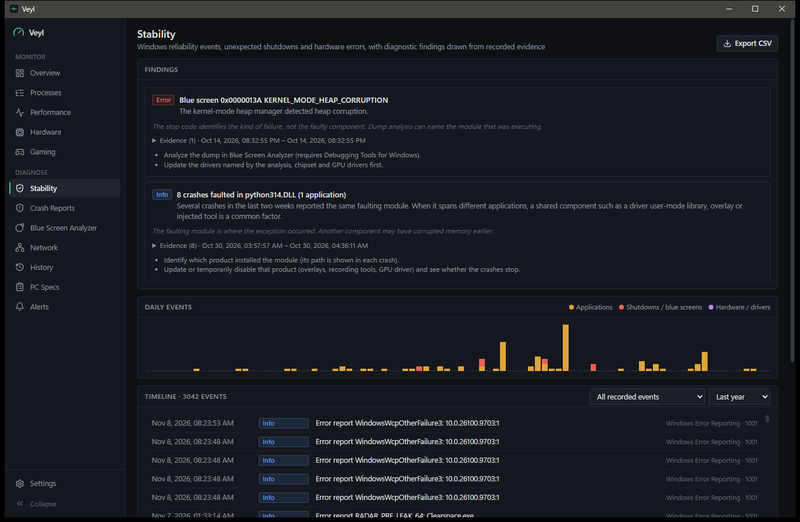

### Network packet capture and protocol analyzer

A Wireshark-style packet capture built on Windows' own built-in capture, with no Npcap or other
third-party driver to install. It decodes Ethernet, Wi-Fi, ARP, IPv4, IPv6, TCP, UDP, ICMP,
DNS, mDNS, HTTP, TLS (with the server name), SMB2, QUIC and DHCP layer by layer, with a hex and
ASCII view. Display filters such as `ip.addr == 192.168.1.10 and tcp.port == 443`,
`dns.qry.name contains "update"` or `tcp.flags.reset` find specific hosts, ports or errors
among thousands of packets. Captured packets stay in memory and are never saved or sent.

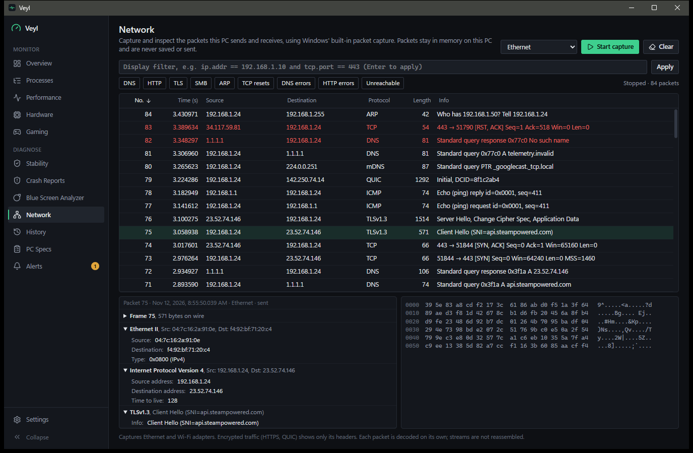

### FPS counter, in-game FPS overlay and frame-time analysis

- **Automatic.** Capture starts by itself when a game opens and stops when it closes, and the
  session is saved. A game is a program with a window that is on Windows' Game Bar list or runs
  from a Steam, Epic, GOG, EA, Ubisoft or Xbox library. Apps that Steam itself lists as software
  or tools (Blender, OBS Studio, Wallpaper Engine...) are left out.
- **The numbers that matter.** Average FPS, 1 % and 0.1 % lows, 95th and 99th percentile frame
  times, stutter and frame pacing, with CPU and GPU load and temperatures recorded alongside.
  Save sessions, compare two of them, or export them to CSV.
- **In-game FPS overlay.** It appears only while a game is the active window, never over other
  apps. It sits on the game's own window at any of nine spots (corners, edges or centre) and
  follows the window when it moves.
- **17 overlay designs in four themes.** Sleek Compact, Sleek Rings, Sleek Meters, Sleek Side,
  Performance, and laptop and TV layouts, each in Dark, Smoke, Float or White, from
  [Apple-Style RTSS Overlays](https://github.com/realHfde/Apple-Style-Inspired-RTSS-Overlay) by
  realHfde (MIT). Pick one on the Gaming page with a live preview. Veyl draws them with its own
  readings, so RivaTuner and MSI Afterburner aren't needed, and the Inter font they use is bundled.
- **Nothing injected into the game.** Frame times come from Intel PresentMon, which reads the
  timing events Windows already records. One click on the Gaming page installs it.

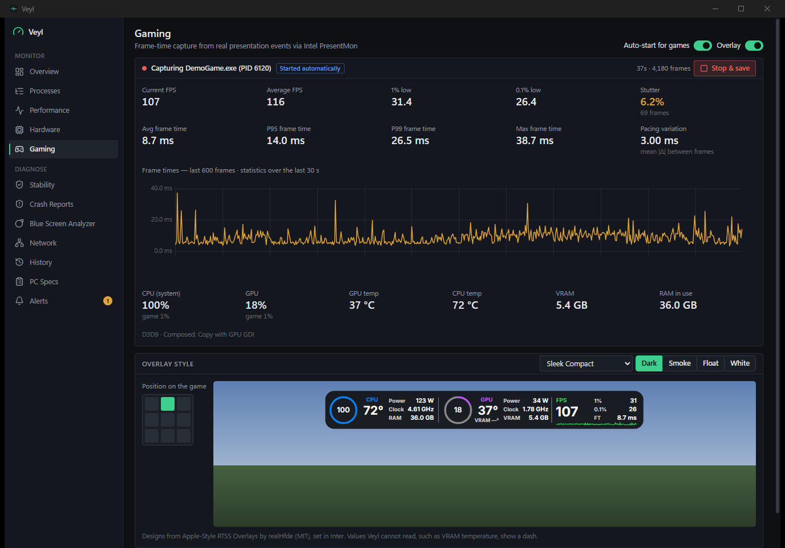

### Performance history and CSV export

Telemetry is recorded in 5-second detail (kept 48 hours by default) and 1-minute detail (kept
30 days). You can chart any range from 15 minutes to 30 days, toggle metrics by category, and
export to CSV. Periods when Veyl wasn't running are shaded, never filled in.

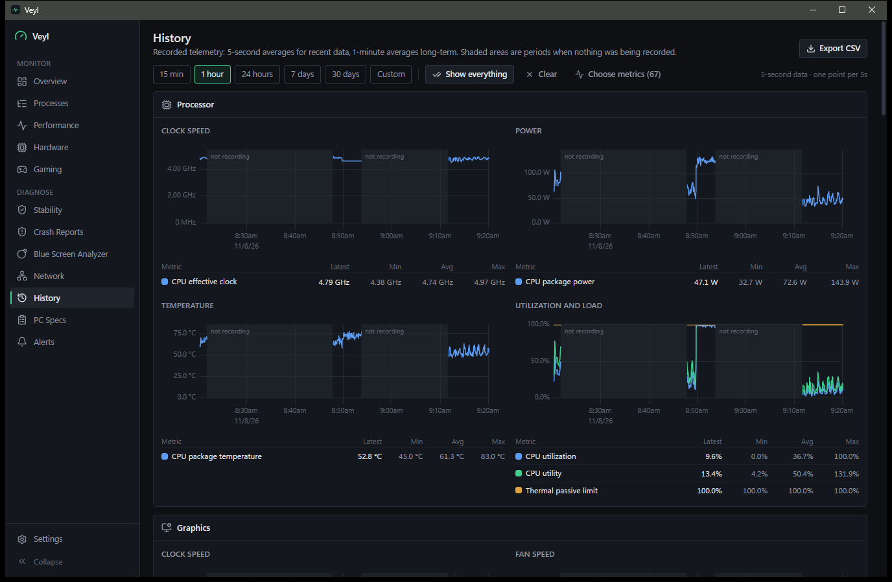

### PC specs and system information

A complete hardware inventory read from the firmware (SMBIOS) and Windows:

- **System:** manufacturer and Windows version.
- **CPU:** model, cores and threads, cache sizes and socket.
- **Motherboard and BIOS:** model and BIOS version.
- **Memory:** every RAM module with size, type, speed and part number.
- **Graphics:** GPU and driver version, plus every monitor with its resolution and refresh rate.
- **Drives and network adapters.**

You can export it as TXT or CSV. Serial numbers and the computer name are left out, so the
export is safe to post in a support forum.

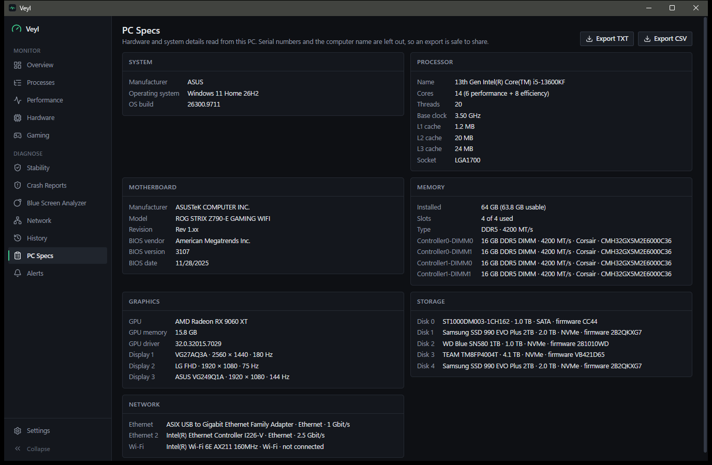

### Alerts and notifications

Threshold alerts for temperatures, memory, disk space, CPU load and thermal throttling, each with
a trigger delay, hysteresis and cooldown so they don't flap. There are also alerts for a new blue
screen, an unexpected restart or an app that keeps crashing. Alerts appear as Windows
notifications, and their history is kept.

## Download and install

1. Download `Veyl_x.y.z_x64-setup.exe` from the
   [latest release](https://github.com/LunoviaVR/Veyl/releases/latest).
2. Run it. It installs for all users into Program Files, and Windows asks for administrator
   permission.
3. Start **Veyl** from the Start menu. It runs as administrator (Windows shows a UAC prompt)
   so it can read crash dumps, capture frames and packets, and show full process details.

Closing or minimizing the window keeps Veyl running in the notification area (configurable in
**Settings → General**); use the tray icon's **Exit** to quit. Updates are checked on GitHub
Releases, verified against a signature, and installed only when you click **Install and
restart**. Uninstalling keeps your data folder (`%LOCALAPPDATA%\app.veyl.monitor`) unless
you delete it.

### System requirements

- Windows 11 x64 (primary target) or Windows 10 x64 21H2 or later.
- The WebView2 runtime, which is part of Windows 11 and installed automatically on Windows 10.
- Memory: about 76 MB for the monitoring backend, about 250 MB in total with the window open.

### Optional add-ons

None of these are bundled. Without one, its page explains what is missing and everything else
keeps working.

| Add-on | What it adds | How to get it |
|---|---|---|
| [PawnIO](https://pawnio.eu) (open source, Microsoft-signed) | CPU temperatures (Intel); motherboard fans, voltages and temperatures (Nuvoton) | Install PawnIO. Veyl ships only PawnIO's official signed modules, never the driver. |
| [Intel PresentMon](https://github.com/GameTechDev/PresentMon) (MIT) | FPS and frame-time capture | Click **Install PresentMon** on the Gaming page: Veyl downloads Intel's official release from GitHub, keeps it only if it matches the published checksum, and saves it in its `tools` folder. Or place the console app there yourself. |
| Debugging Tools for Windows | Blue screen dump analysis (`!analyze -v`) | Install "Debugging Tools for Windows" from the Windows SDK installer. Veyl finds it automatically. |
| Microsoft symbol server | Named functions and modules in dump analysis | Off by default. Turn it on in **Settings → Integrations**. Only symbol files are downloaded; dumps never leave your PC. |

## Privacy and security

- **No telemetry, no account, no cloud.** History, settings and logs stay in
  `%LOCALAPPDATA%\app.veyl.monitor`.
- **Network requests:** only the update check (can be turned off), the optional symbol
  downloads, and the PresentMon download when you click **Install PresentMon**.
- **Exports** are written only to files you choose, with optional removal of your user name,
  profile path, computer name, account IDs (SIDs) and drive serial numbers.
- **Packet captures** stay in memory, are never written to disk, and are cleared when you start a
  new capture or close Veyl.
- **No drivers installed.** Packet capture uses Windows' built-in capture, and PawnIO is
  installed by you.
- **Administrator rights, safely.** Because Veyl runs as administrator, it only lives in, and
  only starts helper programs from, folders that ordinary programs can't change (Program Files
  and Windows). Critical Windows processes can't be ended from Veyl.

## FAQ

**How do I check my CPU temperature on Windows 11?**
Windows does not expose CPU core temperatures to normal apps. Install the free
[PawnIO](https://pawnio.eu) driver, start Veyl, and open **Hardware**. The CPU package and
every core's temperature appear there and on the Overview page. Intel CPUs are supported
today.

**How do I find out why my PC crashed with a blue screen?**
Open **Blue Screen Analyzer**. It lists each bugcheck with its stop code and a plain
explanation. With Debugging Tools for Windows installed, click **Analyze** on the matching dump
to see the driver or module that failed. Turn on the symbol server in Settings for the most
precise result.

**Why did my PC restart without a blue screen?**
Veyl shows these as *unexpected shutdowns* (Kernel-Power 41 with no stop code). Common causes
are power loss, a power supply problem, a hard freeze, or holding the power button. Check the
recorded temperatures and load from just before the restart on the same page.

**Is Veyl a Wireshark alternative?**
For everyday troubleshooting, yes. It captures live traffic, decodes common protocols and
supports Wireshark-style display filters, without installing Npcap. It does not save `.pcap`
files or reassemble TCP streams. For deep protocol work, Wireshark remains the specialist tool.

**Does the FPS counter work with anti-cheat games?**
Veyl measures FPS with Intel PresentMon, which reads presentation events that Windows already
records. Nothing is injected into the game process.

**Does Veyl have an in-game FPS overlay like RivaTuner?**
Yes, without RivaTuner or Afterburner. Turn on **Overlay** on the Gaming page, then pick its
design, theme and position there. It shows over borderless and windowed games while they are the
active window; games in exclusive fullscreen draw over it.

**Which games does Veyl detect automatically?**
Programs with a window that Windows' Game Bar knows as games, or that run from a Steam, Epic, GOG,
EA, Ubisoft or Xbox library (minus the apps Steam lists as software). If one is missed, press
Win+G in the game and tick "Remember this is a game", or click **Capture** next to it on the
Gaming page.

**Does Veyl install a kernel driver?**
No. Packet capture uses Windows' built-in capture filter. CPU and motherboard sensors use the
PawnIO driver only if you installed it yourself.

**Why does Veyl need administrator rights?**
Reading kernel crash dumps, capturing frame times and network packets, and showing details of
system processes all require them. Everything else would work as a standard user.

**Does Veyl collect data or need an account?**
No. There is no telemetry and no account, and all data stays on your PC.

## Troubleshooting

<details>
<summary>Common problems and fixes</summary>

| Symptom | Cause and fix |
|---|---|
| CPU "Package temp —" | Windows exposes CPU die temperatures only to kernel drivers. Install PawnIO. |
| GPU hotspot "not reported" | Shown for AMD (ADLX) and NVIDIA (NVML) GPUs when the driver reports it; Windows alone reports only the edge temperature. |
| GPU power "not reported" | Your driver does not report power to Windows (common on AMD). |
| Overlay not showing | It appears only while a detected game is the active window, and only over borderless or windowed games. Check that **Overlay** is on at the top of the Gaming page. |
| Capture didn't start for a game | Press Win+G in the game and tick "Remember this is a game", or click **Capture** next to it on the Gaming page. |
| Gaming: "PresentMon not found" | Click **Install PresentMon** on the Gaming page, or put `PresentMon-x.y.z-x64.exe` in the tools folder inside Veyl's Program Files folder. |
| Network: "needs administrator rights" | Start Veyl from the Start menu (it runs as administrator), or add your account to *Performance Log Users*. |
| No dump files listed | Windows keeps minidumps only when *Startup and Recovery → Write debugging information* is on, and deletes old ones itself. |
| History empty for a period | Veyl wasn't running then; gaps are shaded, never filled in. |
| Logs | **Settings → About → Logs** (`%LOCALAPPDATA%\app.veyl.monitor\logs`). Set `VEYL_LOG=debug` for more detail. |

</details>

## Build from source

<details>
<summary>Toolchain, commands and releases</summary>

Requirements and extension guides are in [DEVELOPMENT.md](DEVELOPMENT.md).

```powershell
npm install
npm run tauri dev                                            # run in development (not elevated)
npm run tauri build                                          # release exe + installer in target/release/bundle/nsis
powershell -ExecutionPolicy Bypass -File scripts/check.ps1   # formatting, lints, all tests, build
```

**Publishing a release (auto-update):**

1. The updater endpoint is
   `https://github.com/LunoviaVR/Veyl/releases/latest/download/latest.json`; change
   `plugins.updater.endpoints` in `src-tauri/tauri.conf.json` if the repository name differs.
2. Add the repository secrets `TAURI_SIGNING_PRIVATE_KEY` (the contents of
   `%USERPROFILE%\.tauri\veyl.key`) and `TAURI_SIGNING_PRIVATE_KEY_PASSWORD` (empty). Back
   the key up: without it, installed copies cannot be updated.
3. Bump the version in `src-tauri/tauri.conf.json`, `package.json` and `Cargo.toml`, commit,
   and push a tag `vX.Y.Z`. The *Release* workflow builds, signs and drafts the release;
   publish the draft to deliver the update.

</details>

## Documentation

- [ARCHITECTURE.md](ARCHITECTURE.md): modules, threads, data flow, security boundaries
- [COMPATIBILITY.md](COMPATIBILITY.md): supported hardware, Windows versions and limitations
- [PERFORMANCE.md](PERFORMANCE.md): measured CPU and memory overhead
- [docs/METRICS.md](docs/METRICS.md): exact definition of every metric
- [DEVELOPMENT.md](DEVELOPMENT.md): adding sensor providers, diagnostic rules and pages
- [IMPLEMENTATION_STATUS.md](IMPLEMENTATION_STATUS.md): what is done, partial or unsupported
- [THIRD_PARTY_NOTICES.md](THIRD_PARTY_NOTICES.md): bundled and used third-party components
